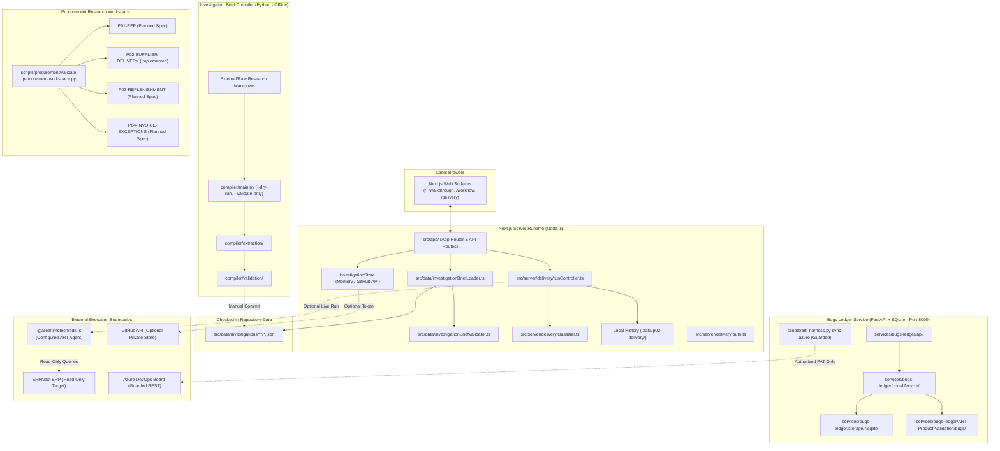

# Repository Current State

Last updated: 2026-10-26

## 1. What This Repository Does

The ART Investigation Lab repository houses several related but strictly isolated engineering and research workspaces:

1. **Core Web Application (`src/`):** A Next.js (App Router) application that renders validated investigation briefs across five main product surfaces:
   - Homepage (`/`)
   - Onboarding (`/onboarding`)
   - Contribute (`/contribute`)
   - Walkthrough (`/walkthrough`)
   - Workflow (`/workflow`)
2. **P02 Delivery Control Center (`/delivery`):** An operations center for monitoring supplier purchase orders, receipt evidence, and delivery delays. Includes deterministic delivery classification, read-only ART ADK agent execution, local run auditing, and strictly labeled synthetic demo data.
3. **Investigation Brief Compiler (`compiler/`):** A standalone Python CLI tool that parses Markdown investigation packages, extracts structured epistemic entities, and validates candidate JSON against the InvestigationBrief schema.
4. **Procurement Research Workspace (`research/procurement/`):** A structured research workspace defining ownership, evidence standards, and specifications for 4 procurement processes (P01–P04), governed by `validate-procurement-workspace.py`.
5. **Bugs Ledger Service (`services/bugs-ledger/`):** An independent Python FastAPI service with SQLite persistence for defect tracking, life-cycle transitions, evidence hashing, and optional guarded Azure DevOps synchronization.

---

## 2. Component Boundaries & Runtime Topography

### Key Architectural Boundaries:
1. **Compiler vs. Web Application:** The investigation compiler is an offline CLI utility. It does NOT run inside the Next.js process, does not watch files, and does not automatically re-bundle briefs. Compiled JSON briefs must be validated and committed into `src/data/investigations/`.
2. **Bugs Ledger vs. Delivery Control Center:** The bugs-ledger FastAPI service is completely independent of the Next.js server runtime. Defect ingestion, verification retests, and SQLite persistence operate on port 8000 and do not share runtime state with `/delivery`.
3. **P02 Delivery Control Center vs. ERPNext:** The control center does not execute SQL or direct write operations on ERPNext. Live execution communicates via `@arealtimetech/adk-js` to a read-only ART agent. If ART is unconfigured or credentials are missing, the system operates in demo mode using strictly labeled synthetic records.
4. **Procurement Research Workspace:** `research/procurement/` is an evidentiary research workspace. P02 is the only procurement process implemented in the application UI; P01, P03, and P04 are planned research specifications.

---

## 3. Verified Build and Test State

| Test Suite | Command | Executed Scope | Result | Passing Test Count |
|---|---|---|---|---|
| **Core Web App (Node.js)** | `npm test` (`node scripts/run-tests.mjs`) | Persistence, WebAuthn session, P02 delivery classifier, ADK boundaries, audit trails | **PASS** | **68 passed**, 0 failed |
| **Investigation Compiler (Python)** | `python -m pytest compiler/tests` | Compiler package loader, extraction spec, Pydantic validation | **PASS** | **14 passed**, 0 failed |
| **Bugs Ledger Service (Python)** | `python -m pytest tests` (in `services/bugs-ledger/`) | Bug intake, read-only query service, lifecycle transitions, SQLite storage, feature paths | **PASS** | **354 passed**, 0 failed |
| **Procurement Workspace Validation** | `python scripts/procurement/validate-procurement-workspace.py` | Scope boundaries, all 4 process packages (P01–P04), link resolution, secret scan, ID integrity | **PASS** | **5/5 categories passed** |
| **Bugs Ledger Link & Schema Check** | `python scripts/validation/validate-art-bugs.py --bugs-root services/bugs-ledger/ART-Product-Validation/bugs` | Bug file structure, status tags, evidence link existence | **PASS** | **39 bugs, 145 evidence links valid** |
| **Unified Validation Harness** | `python scripts/art_harness.py validate` | Runs procurement validation, bug link validation, and bugs-ledger pytest suite | **PASS** | **Clean pass across all 3 steps** |
| **Next.js Production Build** | `npm run build` | Next.js compilation, TypeScript typecheck (`tsc`), page generation | **PASS** | **6 static / dynamic routes built cleanly** |

---

## 4. Operational & Security Safeguards

- **Strict Epistemic Safeguards in P02:** Missing receipt pagination, partial line-item links, unexhausted page counts, and conflicting supplier dates always result in `NEEDS_VERIFICATION`. Received quantities are never inferred or assumed.
- **Zero-Fabrication Demarcation:** Synthetic demo data is explicitly labeled as `DEMO` across headers, table rows, and metrics cards. It cannot be mistaken for live ERPNext data.
- **Credential Safety:** No credentials, API tokens, or session secrets are checked into Git. `.env` files and SQLite databases (`*.db`, `*.sqlite`) are gitignored.
- **Least-Privilege Delivery Monitoring:** Live agent runs only query read-only ERPNext DocTypes (`Purchase Order`, `Purchase Receipt`).
