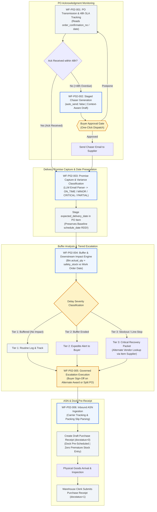
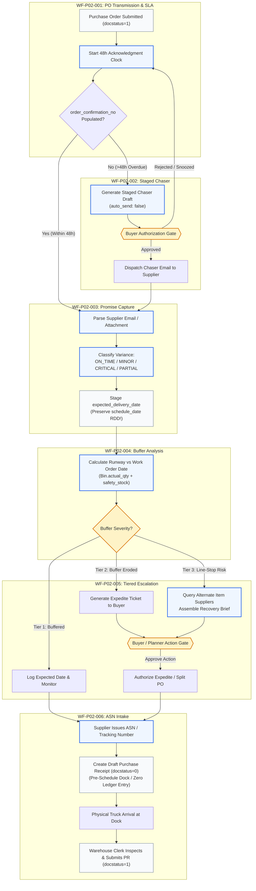

# Proposed End-to-End Workflow: Supplier Delivery Confirmation & Delay Escalation (P02-SUPPLIER-DELIVERY)

> **Document Status:** `PROPOSED — AWAITING OWNER APPROVAL`**Process ID:** `P02-SUPPLIER-DELIVERY`**Process Name:** Supplier Delivery Confirmation & Delay Escalation (Purchase Order to Supplier Delivery)**Process Owner:** Vrushali (`research/procurement/OWNERSHIP.md`)**Governing Standards:** [`../../RESEARCH_STANDARD.md`](../../RESEARCH_STANDARD.md) | [`../../MASTER_PROMPT.md`](../../MASTER_PROMPT.md)**Canonical Specifications Referenced:**
>
> - [`workflow.md`](workflow.md) (Canonical 6 steps: `WF-P02-001` through `WF-P02-006`)
> - [`investigation.md`](investigation.md) (PO acknowledgment lifecycle, promise capture, and buffer analysis)
> - [`evidence.md`](evidence.md) (Confirmation fields, SLA clocks, and notification dispatch)
> - [`governance.md`](governance.md) (`auto_send: false` invariant, human authorization boundaries)
> - [`benchmark-DELIVERY-001.md`](benchmark-DELIVERY-001.md) (`TC-DEL-001` through `TC-DEL-006` synthetic fixtures)
> - [`toolusecase.md`](toolusecase.md) & [`vrushali-task-outcomes-report.md`](vrushali-task-outcomes-report.md) (REST tool status, `HTTP 403` child-table error)
>   **ERPNext/Frappe Source Evidence Baseline:**
> - ERPNext: `version-16` (commit `fd97695de7bfeb1d7728a7370c3e128d0cc1509e`)
> - Frappe: `version-16` (commit `4515014c87ece6cb20ee91d2cfb121c5cbd1ff4a`)
> - Lab Baseline: `research/cross-workflow-automation-baseline/ART-P01-P04-Automation-Baseline.md`

---

## SECTION 1 — DOCUMENT CONTROL

### 1.1 Metadata and Authority

| Dimension                           | Attribute Specification                                                                                                                                                           |
| :---------------------------------- | :-------------------------------------------------------------------------------------------------------------------------------------------------------------------------------- |
| **Workflow Name**             | Supplier Delivery Confirmation & Delay Escalation (PO to Delivery)                                                                                                                |
| **Process ID**                | `P02-SUPPLIER-DELIVERY`                                                                                                                                                         |
| **Process Owner**             | **Vrushali**                                                                                                                                                                |
| **Document State**            | `PROPOSED — AWAITING OWNER APPROVAL`                                                                                                                                           |
| **Lifecycle Stage**           | Target Architecture for ART Agent Lab Product Validation                                                                                                                          |
| **ERPNext & Frappe Versions** | ERPNext `version-16` (`fd97695de7bfeb1d7728a7370c3e128d0cc1509e`) / Frappe `version-16` (`4515014c87ece6cb20ee91d2cfb121c5cbd1ff4a`)                                      |
| **Canonical Step Coverage**   | **6 / 6 Canonical Steps** (`WF-P02-001`, `WF-P02-002`, `WF-P02-003`, `WF-P02-004`, `WF-P02-005`, `WF-P02-006`) + Synthetic Benchmark Specifications (`TC-DEL-001`..`006`, `SPECIFIED_SYNTHETIC`) |

### 1.2 Purpose, Scope, and Explicit Exclusions

- **In-Scope:**
  1. PO submission monitoring and 48-hour acknowledgment SLA clock initialization (`WF-P02-001`).
  2. Context-aware supplier chaser staging with strict human review (`WF-P02-002`, `auto_send: false`).
  3. Unstructured supplier email promise parsing, variance classification, and write-back staging into `PurchaseOrderItem.expected_delivery_date` while preserving contractual `schedule_date` (`WF-P02-003`).
  4. Multi-echelon runway analysis against `Bin.actual_qty`, `Item.safety_stock`, and open `Work Order` dates (`WF-P02-004`).
  5. Tiered recovery orchestration (Tier 1 Routine Log, Tier 2 Buyer Expedite, Tier 3 Critical Line-Stop with alternate vendor lookup) (`WF-P02-005`).
  6. Inbound Advance Shipping Notice (ASN) parsing and **Draft `Purchase Receipt` (`docstatus=0`)** preparation for dock pre-scheduling (`WF-P02-006`).
- **Explicit Exclusions:**
  1. Submitting a `Purchase Receipt` (`docstatus=1`) before goods are physically inspected on the dock (preventing false inventory inflation and `validate_posting_time` future date crashes).
  2. Direct REST querying of child table `/api/resource/Purchase Order Item` without `parent=Purchase Order` parameter (solving the runtime `HTTP 403 Forbidden` error).
  3. Autonomous external email dispatch (all communications staged with `auto_send: false`).

---

## SECTION 2 — INDUSTRY BUSINESS SCENARIO

### 2.1 Corporate Scenario

**Vanguard Precision Manufacturing Ltd.** manufactures industrial sensor units. Production lines consume high-precision micro-controllers (`P02-TEST-ITEM-001`). A submitted Purchase Order (`PUR-ORD-2026-00001`) is issued to primary vendor **ElectroTech Supply Corp** for 500 units with a Requested Delivery Date (RDD) of 2026-10-25. The assembly line is scheduled to start Work Order `MFG-WO-2026-00015` on 2026-10-27. Safety stock in the main store is only 40 units, representing 2 days of production buffer.

### 2.2 Core Business Problem

Suppliers frequently do not acknowledge POs within 48 hours. When they finally respond, they send unstructured emails (*"We have a component delay; we can ship 200 units on October 29th and the remaining 300 on November 10th"*). In traditional operations, buyers fail to read the email in time or manually overwrite the ERP PO delivery date—destroying the contractual baseline date. The production line runs out of parts on October 27th, resulting in an unbuffered line-stop costing $15,000 per shift.

### 2.3 Process Boundaries

- **Trigger:** Submission of an authorized Purchase Order (`docstatus = 1`, `status = "To Receive and Bill"`).
- **Participating Human Roles:** Purchasing Agent / Buyer, Expediter, Production Planner, Warehouse Receiving Clerk, Supplier AR/Order Desk.
- **Existing Enterprise Systems:** ERP Buying & Stock modules (ERPNext `Purchase Order`, `Bin`, `Work Order`), Email/Communication infrastructure.
- **Required Source Records:** Submitted `Purchase Order`, `Item` master (safety stock, lead times), `Bin` (on-hand, reserved, projected), active `Work Order` schedule, Supplier contact record.
- **Start Condition:** PO reaches `docstatus = 1`; `transaction_date` recorded; acknowledgment clock begins.
- **Successful End Condition:** Supplier confirms on-time delivery (or approved revised date), ASN received, Draft PR staged, and parts physically received at warehouse dock.
- **Business Exception End Condition:** Supplier reports critical delay with line-stop impact; buyer executes Tier 3 escalation (split PO or alternate vendor sourcing).

---

## SECTION 3 — AS-IS TRADITIONAL INDUSTRY WORKFLOW

*Representative AS-IS industry workflow observed in mid-market manufacturing enterprises:*

```text
[Purchase Order Submitted & Emailed to Vendor]
             │
             ▼
   [Step 1: Passive Waiting for Acknowledgment] (No automated SLA clock; PO sits in "To Receive")
             │
             ▼
   [Step 2: Ad-Hoc Expediting & Manual Chasers] (Buyer notices silence 5 days later; sends manual email)
             │ ◄── (Operational Failure: Supplier ignored email; buyer chased 3 days too late)
             ▼
   [Step 3: Unstructured Email Reply Received] (Supplier writes: "Partial delay to Oct 29th")
             │
             ▼
   [Step 4: Manual PO Date Overwrite] (Buyer edits PO schedule_date directly in ERP)
             │ ◄── (Data Failure: Baseline contractual RDD lost; supplier OTD metrics corrupted)
             ▼
   [Step 5: Disconnected Buffer Check] (Buyer does not check Work Order schedule)
             │ ◄── (Operational Gap: Production runs out of stock on Oct 27th; line stops)
             ▼
   [Step 6: Surprise Dock Arrival] (Carrier arrives with boxes without prior ASN notice)
             │
             ▼
   [Manual Warehouse Inspection & System Receipt Entry]
```

### Detailed AS-IS Step Inventory

| Step ID                      | Department         | Human Action                                                                                         | Existing System Action                                                                                       | Input Artifacts                        | Output Artifacts                  | Bottlenecks & Operational Failures                                                            |
| :--------------------------- | :----------------- | :--------------------------------------------------------------------------------------------------- | :----------------------------------------------------------------------------------------------------------- | :------------------------------------- | :-------------------------------- | :-------------------------------------------------------------------------------------------- |
| **1. Transmission**    | Purchasing         | Generates PDF from ERP, attaches to email, sends to vendor contact.                                  | ERP sets PO status to `"To Receive and Bill"`. Passive fields `order_confirmation_no/date` remain empty. | Submitted PO PDF.                      | Sent email record.                | Zero automated tracking of whether vendor acknowledged within 48h.                            |
| **2. Chasing**         | Buyer / Expediter  | Manually reviews open PO list in spreadsheets; notices PO unconfirmed after 5 days; drafts reminder. | Frappe `Notification` (if configured) auto-sends without buyer staging, spamming vendor.                   | Open PO report.                        | Manual reminder email.            | Chasers sent reactively; no priority tied to inventory runway or buffer risk.                 |
| **3. Promise Capture** | Buyer              | Reads vendor reply email; attempts to interpret complex split-shipment text.                         | None (email sits in Outlook inbox).                                                                          | Vendor email reply.                    | Buyer mental note or sticky note. | Data trapped in personal inboxes; delays of 24–48 hours before ERP update.                   |
| **4. Date Update**     | Purchasing         | Clicks "Update Items" on PO; updates `schedule_date` to promised date.                             | `accounts_controller.py:update_child_qty_rate` overwrites `schedule_date`.                               | Vendor email text.                     | Modified PO record.               | Contractual Requested Delivery Date (RDD) overwritten; cannot measure On-Time Delivery (OTD). |
| **5. Buffer Check**    | Production Planner | Discovers delay during weekly Monday production meeting.                                             | Manual query of `Bin` and `Work Order`.                                                                  | Production schedule, ERP stock screen. | Urgent expedite request.          | Delay identified too late; expediting air freight costs incurred or line stops.               |
| **6. Dock Receipt**    | Warehouse Dock     | Truck arrives; clerk unloads boxes, manually inspects packing slip, types `Purchase Receipt`.      | ERP creates `Purchase Receipt` and posts Stock Ledger Entry.                                               | Paper packing slip, physical boxes.    | Submitted `Purchase Receipt`.   | No advance warning (ASN); dock bottlenecks during peak hours.                                 |

---

## SECTION 4 — TO-BE ART-ASSISTED WORKFLOW



### 4.1 Step-by-Step TO-BE Specification

#### `WF-P02-001` — PO Transmission & Acknowledgment Clock Initialization

- **Proposed ART Agent / Capability:** PO Acknowledgment SLA Monitor (`OPP-P02-001`, `OPP-P02-002`).
- **Existing ERPNext Reused:** `Purchase Order` submitted record (`status = "To Receive and Bill"`), passive fields `order_confirmation_no` and `order_confirmation_date` (`purchase_order.json:248-260`).
- **Input Contract:** Submitted PO list where `status in ["To Receive and Bill", "To Receive"]` and `order_confirmation_no is null`.
- **API Boundary & Limitation Fix:** To avoid the `HTTP 403 Forbidden` error caused by `DatabaseQuery._set_permission_map` (`db_query.py:630-638`), tool queries must target parent `/api/resource/Purchase Order` with child filter `filters=[["Purchase Order Item", "item_code", "=", "..."]]` (or pass `parent=Purchase Order`).
- **Logic:** Evaluates $\text{elapsed\_hours} = \text{now}() - \text{transaction\_date}$. If $\text{elapsed\_hours} > 48\text{h}$ and `order_confirmation_no` is blank, marks state `ACK_OVERDUE`.

#### `WF-P02-002` — Automated Chaser & Supplier Follow-Up

- **Proposed ART Agent / Capability:** Context-Aware Supplier Chaser Generator (`OPP-P02-003`).
- **Existing ERPNext / Frappe Reused:** `Supplier` primary email contact, Frappe `Communication` DocType.
- **Critical Safety Invariant (`governance.md`):** Frappe's native `Notification.send_an_email()` (`notification.py:515-581`) immediately calls `frappe.sendmail()` without human review. ART strictly overrides this: all chaser messages are generated with `auto_send: false` and presented to the Buyer in a staged dashboard for one-click approval before dispatch.
- **Output Contract:** Staged email payload (Subject, Recipient, Body, PO details, urgency level based on inventory runway).

#### `WF-P02-003` — Delivery Promise Capture & Date/Qty Reconciliation

- **Proposed ART Agent / Capability:** Supplier Communication & Promise Parser (`OPP-P02-004`).
- **Existing ERPNext Reused:** `PurchaseOrderItem.expected_delivery_date` (`purchase_order_item.json:167-173`, `allow_on_submit: 1`).
- **Critical Architectural Invariant:** Never overwrite `PurchaseOrderItem.schedule_date` when recording a revised promise! Overwriting `schedule_date` destroys the baseline RDD needed to compute supplier delivery delay ($\Delta \text{days} = \text{promised\_date} - \text{schedule\_date}$). ART stages the revised promise in `expected_delivery_date`.
- **Classification Taxonomy:** `ON_TIME_FULL`, `MINOR_DELAY` ($\le 3$ days), `CRITICAL_DELAY` ($> 3$ days), `PARTIAL_SHIPMENT`, `SUPPLIER_REJECTION`.

#### `WF-P02-004` — Buffer Analysis & Downstream Impact Assessment

- **Proposed ART Agent / Capability:** Manufacturing Buffer & Pegging Evaluator (`OPP-P02-005`).
- **Existing ERPNext Reused:** `Bin.actual_qty` (`bin.py:80-90`), `Item.safety_stock`, open `Work Order.planned_start_date`.
- **Impact Formula:**

  $$
  \text{runway\_days} = \frac{\text{actual\_qty} + \text{safety\_stock}}{\text{daily\_production\_consumption\_rate}}
  $$

  $$
  \text{buffer\_margin\_days} = \text{Work Order planned\_start\_date} - \text{expected\_delivery\_date}
  $$
- **Severity Mapping:**

  - $\text{buffer\_margin\_days} \ge 2$: **Tier 1 (Routine / Buffered)**.
  - $0 \le \text{buffer\_margin\_days} < 2$: **Tier 2 (Buffer Eroded / Expedite Required)**.
  - $\text{buffer\_margin\_days} < 0$: **Tier 3 (Negative Buffer / Imminent Line-Stop)**.

#### `WF-P02-005` — Tiered Escalation & Recovery Orchestration

- **Proposed ART Agent / Capability:** Supply Recovery Orchestrator (`OPP-P02-005`).
- **Existing ERPNext Reused:** `Item Supplier` child table, historical `Supplier Quotation` records.
- **Actions by Tier:**
  - **Tier 1:** Auto-log revised promise in `expected_delivery_date`; update status dashboard.
  - **Tier 2:** Generate buyer expedite ticket; draft carrier overnight upgrade request.
  - **Tier 3:** Cross-check alternate approved suppliers in `Item Supplier`; compare historical rates/lead times from `Supplier Quotation`; prepare `Critical Recovery Brief` recommending partial cancellation or split PO award.
- **Governance Gate:** Buyer and Production Planner must explicitly sign off on any alternate vendor award, split PO, or premium freight authorization.

#### `WF-P02-006` — Inbound ASN Intake & Dock Pre-Receipt

- **Proposed ART Agent / Capability:** Inbound ASN & Dock Scheduling Assistant (`OPP-P02-006`).
- **Existing ERPNext Reused:** `make_purchase_receipt` (`purchase_order.py:555-589`).
- **Critical Accounting & System Guard:** `PurchaseReceipt.validate_posting_time()` (`purchase_receipt.py:280-281`) throws `"Posting Date cannot be future date"` if submitted with a future date, and submitting immediately increments physical `Bin.actual_qty`. Therefore, in-transit ASNs **must only create a Draft `Purchase Receipt` (`docstatus = 0`)** or `Shipment` record. The physical warehouse clerk submits (`docstatus = 1`) only upon physical dock arrival and inspection.

---

## SECTION 5 — END-TO-END WORKFLOW DIAGRAM



---

## SECTION 6 — AGENT AND ORCHESTRATION DESIGN

### 6.1 Multi-Agent Topology

| Agent Name                     | Architectural Role                     | Required Capabilities                        | Input Contract                                             | Output Contract                                          | STOP / Failure Condition                                      |
| :----------------------------- | :------------------------------------- | :------------------------------------------- | :--------------------------------------------------------- | :------------------------------------------------------- | :------------------------------------------------------------ |
| **`A1-SLAMonitor`**    | 48h acknowledgment clock tracker       | Scheduled poller via parent-filtered REST    | Open submitted POs (`docstatus=1`)                       | SLA state list (`ACK_ON_TIME`, `ACK_OVERDUE`)        | Abort if API returns `HTTP 403` (check parent filter).      |
| **`A2-ChaserDraft`**   | Context-aware supplier chaser writer   | Email drafting prompt (`auto_send: false`) | Overdue PO details, Supplier email, Buffer days            | Staged email draft JSON                                  | Halt if communication attempt has no buyer review.            |
| **`A3-PromiseParser`** | Unstructured email/promise interpreter | Information extraction LLM                   | Supplier reply text, baseline PO lines                     | Structured promise: promised date, qty, variance         | Flag ambiguous replies (`CONFIDENCE < 0.85`) for buyer.     |
| **`A4-BufferEngine`**  | Stock buffer & pegging calculator      | Deterministic math tool                      | `Bin` stock, `Item` safety stock, `Work Order` dates | Buffer margin days, Severity Tier (1, 2, 3)              | Error if `Bin` record missing for item/warehouse.           |
| **`A5-Recovery`**      | Alternate supplier recommender         | Sourcing optimization tool                   | Item code, shortage qty, target delivery date              | Ranked alternate supplier options from `Item Supplier` | Stop if alternate supplier rate > 20% over budget.            |
| **`A6-ASNParser`**     | Packing slip & carrier ASN extractor   | Vision/OCR document parser                   | Supplier shipping notice email/PDF                         | Structured ASN JSON (carrier, tracking, carton count)    | Halt if shipped qty > PO balance without over-receipt toggle. |

### 6.2 Orchestration Boundaries

- **Sequential Execution:** `A1` identifies overdue ack $\rightarrow$ `A2` stages draft $\rightarrow$ `[Buyer Gate]` $\rightarrow$ Supplier responds $\rightarrow$ `A3` parses promise $\rightarrow$ `A4` assesses buffer $\rightarrow$ `A5` evaluates recovery if Tier 3 $\rightarrow$ `[Planner Gate]` $\rightarrow$ `A6` ingests ASN $\rightarrow$ Draft PR staged.
- **Human-in-the-Loop Checkpoints:**
  1. `Gate 1 (WF-P02-002)`: Authorization to transmit chaser email to vendor.
  2. `Gate 2 (WF-P02-003)`: Approval to record revised `expected_delivery_date` on PO item.
  3. `Gate 3 (WF-P02-005)`: Decision on Tier 2 expedite costs or Tier 3 alternate supplier award.
  4. `Gate 4 (WF-P02-006)`: Physical inspection on dock before PR submission (`docstatus=1`).

---

## SECTION 7 — EXISTING AUTOMATION VERSUS ART OPPORTUNITIES

| Canonical Step ID        | Existing ERP / Industry Automation                                                  | Remaining Manual Work in Traditional Systems                           | Proposed ART Value-Add                                            | Linked Opportunity               | Evidence Status                           | ART Execution Status                     | Priority Tier    |
| :----------------------- | :---------------------------------------------------------------------------------- | :--------------------------------------------------------------------- | :---------------------------------------------------------------- | :------------------------------- | :---------------------------------------- | :--------------------------------------- | :--------------- |
| **`WF-P02-001`** | PO status `"To Receive and Bill"`; passive fields `order_confirmation_no/date`. | No automated 48h clock; manual spreadsheet tracking.                   | Automated 48h Ack SLA tracker (with parent REST query design).    | `OPP-P02-001`, `OPP-P02-002` | `SPECIFIED_SYNTHETIC` (`TC-DEL-001`; read-only smoke test in `workflow.md:173`) | `PLANNED` (REST query fix designed; unexecuted in ART) | **`P0`** |
| **`WF-P02-002`** | Frappe `Notification` (Note: auto-sends without staging!).                        | Buyer types manual emails or spams supplier blindly.                   | Context-aware staged chaser drafts (`auto_send: false`).        | `OPP-P02-003`                  | `SPECIFIED_SYNTHETIC` (`TC-DEL-002`)     | `PLANNED`                              | **`P0`** |
| **`WF-P02-003`** | `update_child_qty_rate` (Note: overwrites baseline `schedule_date`!).           | Buyer reads email, manually edits PO, destroying baseline RDD.         | Email promise parser staging to `expected_delivery_date`.       | `OPP-P02-004`                  | `SPECIFIED_SYNTHETIC` (`TC-DEL-001/003`) | `PLANNED`                              | **`P0`** |
| **`WF-P02-004`** | Static reports (`Purchase Order Trends`, `Delayed Order Summary`).              | Buyer does not check stock runway; production line stops unexpectedly. | Real-time buffer & Work Order impact pegging engine.              | `OPP-P02-005`                  | `SPECIFIED_SYNTHETIC` (`TC-DEL-004`)     | `PLANNED`                              | `P1`           |
| **`WF-P02-005`** | None in ERPNext core (no delay escalation state machine).                           | Chaotic manual phone calls; buyer scrambles for alternate quotes.      | Autonomous Tier 1/2/3 recovery packet & alternate vendor lookup.  | `OPP-P02-005`                  | `SPECIFIED_SYNTHETIC` (`TC-DEL-005/006`) | `PLANNED`                              | `P1`           |
| **`WF-P02-006`** | `make_purchase_receipt` (Note: submit fails on future date!).                     | Paper packing slips typed manually when truck arrives.                 | ASN parser creating Draft `Purchase Receipt` (`docstatus=0`). | `OPP-P02-006`                  | `SOURCE_AND_DOC_SUPPORTED`              | `PLANNED`                              | `P2`           |

---

## SECTION 8 — END-TO-END TEST SCENARIOS

### Scenario 1: Happy-Path On-Time Delivery (`TC-DEL-001`)

- **Status:** `PLANNED` (Synthetic specification defined in `benchmark-DELIVERY-001.md`; not yet executed at runtime in ART)
- **Preconditions:** `PUR-ORD-2026-00001` submitted for 100 units of `P02-TEST-ITEM-001` @ $150; RDD is 2026-10-25.
- **Test Input:** Supplier emails confirmation within 12 hours: *"Confirming order PUR-ORD-2026-00001 for 100 units on October 25th. Order ref: ETS-9921."*
- **Expected Operations:**
  1. `A1` checks PO at $T+12\text{h}$; detects incoming response.
  2. `A3` parses message: `order_confirmation_no: "ETS-9921"`, `promised_date: "2026-10-25"`, `variance: "ON_TIME_FULL"`.
  3. Stages update to `expected_delivery_date = "2026-10-25"` and `order_confirmation_no = "ETS-9921"`.
  4. `schedule_date` remains `"2026-10-25"`.
  5. Buffer analysis confirms 0 days variance; marks Tier 1 Routine.
- **Pass/Fail Criteria:** Baseline `schedule_date` intact; confirmation fields populated; zero chasers generated.

### Scenario 2: Overdue Acknowledgment & Staged Chaser (`TC-DEL-002`)

- **Status:** `PLANNED`
- **Preconditions:** `PUR-ORD-2026-00002` submitted on 2026-10-10; current time is 2026-10-13 ($T+72\text{h}$); `order_confirmation_no` is null.
- **Test Input:** Polling trigger at $T+72\text{h}$.
- **Expected Operations:**
  1. `A1` detects elapsed time $72\text{h} > 48\text{h}$; classifies status `ACK_OVERDUE`.
  2. `A2` drafts reminder email citing PO number, item code, and RDD.
  3. **Safety Check:** Email is **NOT** sent automatically (`auto_send: false`). Staged in Buyer queue.
  4. Buyer clicks `APPROVE_DISPATCH`.
  5. Communication log updated in ERPNext.
- **Pass/Fail Criteria:** Zero unapproved emails sent; staged payload contains correct vendor email and PO details.

### Scenario 3: Buffered Minor Delay — Tier 1 Routine (`TC-DEL-003`)

- **Status:** `PLANNED`
- **Preconditions:** `PUR-ORD-2026-00003` has RDD 2026-10-20. Production Work Order scheduled for 2026-10-28. Safety stock = 100 units (10 days runway).
- **Test Input:** Supplier emails: *"Shipment delayed by 2 days due to customs. Delivery expected October 22nd."*
- **Expected Operations:**
  1. `A3` extracts `promised_date: "2026-10-22"`, `delta_days = +2`.
  2. `A4` computes buffer: Work Order is October 28th; stock runway covers until October 30th. Buffer margin = 6 days.
  3. Classifies as **Tier 1 (Buffered Delay)**.
  4. Generates informational notice for planner; updates `expected_delivery_date = "2026-10-22"`.
- **Pass/Fail Criteria:** System does not trigger unnecessary expedite alarm; baseline `schedule_date` remains 2026-10-20.

### Scenario 4: Critical Delay & Imminent Line-Stop — Tier 3 Recovery (`TC-DEL-004` & `TC-DEL-006`)

- **Status:** `PLANNED`
- **Preconditions:** `PUR-ORD-2026-00004` has RDD 2026-10-15. Work Order starts 2026-10-16. `Bin.actual_qty = 5`, safety stock = 10 (less than 24 hours of stock).
- **Test Input:** Supplier emails: *"Factory equipment breakdown. We cannot deliver until November 5th."*
- **Expected Operations:**
  1. `A3` parses date: `promised_date = "2026-11-05"`, `delta_days = +21`.
  2. `A4` computes runway: stock exhausts on October 16th. Buffer margin = **-20 days**.
  3. Classifies as **Tier 3 (Critical Line-Stop Risk)**.
  4. `A5` queries `Item Supplier` for `P02-TEST-ITEM-001`; identifies secondary supplier **Semicon Direct** with 3-day lead time @ $162/unit.
  5. Assembles `Critical Recovery Brief` proposing split cancellation of PO 00004 and emergency PO to Semicon Direct.
  6. **STOP Condition:** Suspends automated execution pending Buyer & VP Operations approval.
- **Pass/Fail Criteria:** Immediate Tier 3 alert generated; alternate supplier identified; zero autonomous PO creation without human sign-off.

### Scenario 5: Tool API Permission Verification (`TC-DEL-007`)

- **Status:** `PLANNED` (Designed parent-filtered REST query fix for `HTTP 403`; awaiting live ART runtime verification)
- **Preconditions:** ERPNext sandbox with standard API user permissions.
- **Test Input:** Executing tool query for `P02-TEST-ITEM-001`.
- **Expected Operations:**
  1. Tool sends query `GET /api/resource/Purchase Order?filters=[["Purchase Order Item", "item_code", "=", "P02-TEST-ITEM-001"]]`.
  2. Server evaluates `DatabaseQuery._set_permission_map` on parent `Purchase Order`.
  3. Server returns HTTP `200 OK` with JSON array of matching PO names.
  4. Tool queries `/api/resource/Purchase Order/{name}` to extract line details.
- **Pass/Fail Criteria:** Tool successfully returns line items without `HTTP 403 Forbidden` error.

---

## SECTION 9 — EXECUTION ACCEPTANCE CRITERIA

| Acceptance Dimension                       | Rigorous Verification Standard                                                                                                  | Insufficient / Unacceptable Evidence                                                       |
| :----------------------------------------- | :------------------------------------------------------------------------------------------------------------------------------ | :----------------------------------------------------------------------------------------- |
| **1. Individual Agent Validation**   | Promise parser extracts promise dates and split quantities matching human ground truth with 100% precision.                     | Generic LLM summary stating "supplier promised to ship next week".                         |
| **2. Data Handoff**                  | Structured variance data passed to Buffer Engine without loss of baseline PO dates or line item linkages.                       | Manual re-entry of promise dates across disjointed tool tabs.                              |
| **3. Orchestrator Execution**        | Orchestrator halts upon `ACK_OVERDUE` and presents staged chaser; resumes only after human authorization.                     | Automated dispatch of chasers without human approval (`governance.md` violation).        |
| **4. Date Preservation**             | Contractual `PurchaseOrderItem.schedule_date` is 100% immutable; revised promises written only to `expected_delivery_date`. | Overwriting `schedule_date` directly in ERPNext database.                                |
| **5. Tool / API Operation**          | Child-table queries inherit parent permissions without `HTTP 403 Forbidden` exceptions.                                       | Unhandled REST 403 errors in execution logs (`vrushali-task-outcomes-report.md`).        |
| **6. Business Outcome**              | Complete avoidance of unbuffered line-stops through timely buffer alerting and alternate vendor sourcing.                       | Discovering delivery delays only after assembly line halts.                                |
| **7. Accounting & Ledger Integrity** | In-transit ASNs staged as Draft `Purchase Receipt` (`docstatus = 0`); physical stock posted only upon dock inspection.      | Submitting PR with future posting date, crashing controller or inflating unverified stock. |

---

## SECTION 10 — IMPLEMENTATION ROADMAP

```mermaid
flowchart LR
    M1["Stage 1: Fix REST Query Tool<br/>(Parent filter fix for HTTP 403)"] --> M2["Stage 2: 48h SLA & Staged Chaser<br/>(auto_send: false Governance)"]
    M2 --> M3["Stage 3: Email Promise Parser<br/>(expected_delivery_date staging)"]
    M3 --> M4["Stage 4: Buffer & Pegging Engine<br/>(Bin + Work Order integration)"]
    M4 --> M5["Stage 5: Tiered Escalation Brief<br/>(Item Supplier alternate lookup)"]
    M5 --> M6["Stage 6: Draft PR ASN Intake<br/>(Dock pre-scheduling sandbox test)"]

    classDef done fill:#dcfce7,stroke:#15803d,stroke-width:2px;
    classDef inprog fill:#fef3c7,stroke:#d97706,stroke-width:2px;
    classDef planned fill:#eff6ff,stroke:#2563eb,stroke-width:1px;

    class M1 inprog;
    class M2,M3,M4,M5,M6 planned;
```



### 10.1 Detailed Implementation Phases

1. **Stage 1: Repair REST Tool Query (`IN PROGRESS`):**
   - Refactor `p02_delivery_find_po_item_lines_by_item_code` to query `/api/resource/Purchase Order` with child filters, resolving the runtime `HTTP 403` error (fix designed from Frappe source inspection; awaiting ART agent execution).
2. **Stage 2: Build 48h SLA Clock & Staged Chaser Engine (`PLANNED`):**
   - Implement background monitor evaluating `now - transaction_date > 48h`.
   - Implement staged chaser drafting tool adhering strictly to `auto_send: false`.
3. **Stage 3: Deploy Email Promise Parser & Date Preservation (`PLANNED`):**
   - Build few-shot LLM parser for supplier delivery promises.
   - Configure write-back to `PurchaseOrderItem.expected_delivery_date` (`allow_on_submit: 1`).
4. **Stage 4: Wire Runway & Work Order Pegging Tool (`PLANNED`):**
   - Attach read tools for `Bin.actual_qty`, `Item.safety_stock`, and `Work Order.planned_start_date`.
5. **Stage 5: Implement Tier 1/2/3 Escalator (`PLANNED`):**
   - Build Recovery Packet generator querying `Item Supplier` and historical `Supplier Quotation` rates.
6. **Stage 6: Execute Full Synthetic Benchmark Suite (`PLANNED`):**
   - Run test scenarios `TC-DEL-001` through `TC-DEL-006` in sandbox against POs `PUR-ORD-2026-00001..00004`.

---

## SECTION 11 — OPEN QUESTIONS AND OWNER APPROVAL

> [!IMPORTANT]
> **Decisions Requiring Process Owner Sign-Off (Vrushali):**
>
> 1. **Target Field for Revised Delivery Dates:** Confirm formal adoption of `PurchaseOrderItem.expected_delivery_date` as the official destination for supplier promise dates so that `schedule_date` remains the immutable contractual RDD baseline.
> 2. **In-Transit ASN Object in ERPNext:** Confirm whether in-transit ASNs should be staged as **Draft `Purchase Receipt` (`docstatus = 0`)** or as **`Shipment`** documents in ERPNext.
> 3. **Chaser Escalation Timeline:** Approve the chaser schedule cadence (e.g., initial chaser at $T+48\text{h}$, second chaser at $T+96\text{h}$, pre-delivery checkpoint at $T-3$ days).
> 4. **Alternate Sourcing Authority:** Define the expenditure threshold beyond which an alternate supplier recommendation must be escalated to the Director of Supply Chain vs Buyer self-approval.

---

## SECTION 12 — EVIDENCE REFERENCES

1. **AIL Canonical Specifications:**
   - [`workflow.md`](workflow.md) — 6 canonical steps (`WF-P02-001`..`006`).
   - [`governance.md`](governance.md) — `auto_send: false` invariant, human authorization rules.
   - [`benchmark-DELIVERY-001.md`](benchmark-DELIVERY-001.md) — Synthetic scenarios `TC-DEL-001`..`006`.
   - [`vrushali-task-outcomes-report.md`](vrushali-task-outcomes-report.md) — Tool execution records, `HTTP 403` failure on child table.
   - [`investigation.md`](investigation.md) & [`evidence.md`](evidence.md) — Confirmation fields and SLA analysis.
2. **ERPNext & Frappe Source Citations (`version-16`):**
   - Child-table permission enforcement (`HTTP 403` root cause): `frappe/model/db_query.py:630-638` & `frappe/permissions.py:848`.
   - Passive confirmation fields on PO: `purchase_order.json:248-260`.
   - `expected_delivery_date` on PO Item: `purchase_order_item.json:167-173`.
   - Direct date overwrite: `accounts_controller.py:4225-4664` (`update_child_qty_rate`).
   - Frappe Notification direct mail dispatch: `frappe/email/doctype/notification/notification.py:515-581`.
   - `PurchaseReceipt` future date validation: `purchase_receipt.py:280-281` (`validate_posting_time`).
   - Cross-Workflow Baseline: `research/cross-workflow-automation-baseline/ART-P01-P04-Automation-Baseline.md`.
