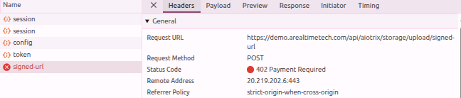
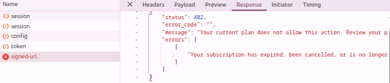

# ART-ADK-001 — ADK file upload to Data Lake fails with 402 Payment Required while upload works in Test UI

## Metadata

- **Canonical Bug ID:** ART-ADK-001
- **Title:** ADK file upload to Data Lake fails with 402 Payment Required while upload works in Test UI
- **Status:** OPEN
- **Feature:** ART Deployment Kit (ADK)
- **Module:** ADK / Data Lake / File Upload
- **Classification:** BUG
- **Severity:** HIGH
- **Priority:** P1
- **Assignee:** Unassigned
- **Environment:** Production / Demo (https://demo.arealtimetech.com, ADK vs Test UI)
- **Tags:** ADK, Data-Lake, File-Upload, Signed-URL, HTTP-402, Subscription-Enforcement, Immospice, P1
- **Date Reported:** 2026-10-12
- **Azure DevOps:** SYNCED

## 1. Problem

File upload to the Data Lake through ADK is currently failing. The same file-upload capability is reported to work through the Test UI, but when the operation is performed through ADK, the signed-upload request fails with HTTP 402 Payment Required. This is blocking Data Lake access/file-upload functionality required for the Immospice client project.

## 2. Observed Behavior

- File upload works through the Test UI.
- File upload does not work through ADK.
- During the ADK upload flow, the application sends a `POST` request to the signed-upload endpoint (`https://demo.arealtimetech.com/api/aiotrix/storage/upload/signed-url`).
- The supplied browser network evidence shows the request returning:
  - **Status Code:** `402 Payment Required`
- The API response contains:
  - `"status": 402`
  - `"error_code": ""`
  - `"message": "Your current plan does not allow this action. Review your plan details to upgrade or renew."`
  - `"errors": [["Your subscription has expired, been cancelled, or is no longer valid."]]`
- As a result, the ADK cannot complete the Data Lake file-upload operation.

## 3. Reproduction

1. Use ADK to perform a file upload to the Data Lake.
2. Trigger the upload flow that requests the signed upload URL.
3. Inspect the network request for the signed-upload operation (`POST /api/aiotrix/storage/upload/signed-url`).
4. Observe that the `POST` request returns `402 Payment Required`.
5. Observe that the file upload cannot proceed.

## 4. Expected Behavior

ADK should be able to perform the supported Data Lake file-upload flow successfully for an account/environment with valid access.

If the same account and capability are available through the Test UI, ADK should not fail because of an inconsistent plan/subscription authorization path.

If the operation genuinely is unavailable for the account's subscription, ADK should return a clear and consistent authorization/subscription error rather than exposing different behavior between Test UI and ADK.

## 5. Business Impact

This is currently blocking a Data Lake dependency required for the Immospice client project. ADK consumers cannot upload the required files even though the corresponding functionality is reported to work through the Test UI.

Because this affects a client-project dependency, the issue requires priority investigation.

## 6. User Experience

The user can validate the file-upload functionality through the Test UI but cannot use the same required capability through ADK. The ADK workflow stops at the signed-upload request with a `402` response, preventing the file from reaching the Data Lake.

## 7. Investigation Guidance

Trace the complete Data Lake file-upload flow for both:

`Test UI → signed upload → Data Lake`

and

`ADK → signed upload → Data Lake`

Compare how authentication, workspace/account context, subscription/plan entitlement, and upload authorization are resolved in both paths.

Specifically investigate why the ADK request to the signed-upload endpoint receives `402 Payment Required` while the equivalent capability is reported to work through the Test UI.

Determine whether both flows are using the same account/workspace context and entitlement validation before concluding that the subscription itself is the root cause.

The `402` response is confirmed by evidence; the underlying reason for the discrepancy between Test UI and ADK is not yet confirmed.

## 8. Fix Requirement

ADK must be able to complete the supported Data Lake file-upload operation when the current account/workspace is authorized for that capability.

Entitlement and authorization behavior must be consistent between the Test UI and ADK for the same valid context.

## 9. Recommended Solution

Compare the authorization and entitlement context generated by the working Test UI upload with the failing ADK upload. Correct the ADK or backend authorization path responsible for the inconsistent `402` response once the actual difference is identified.

Do not bypass legitimate subscription enforcement merely to remove the `402`.

## 10. Minimum Working Fix

Restore the ADK Data Lake upload path so an authorized user can obtain the required signed-upload authorization and successfully upload a file, while retaining valid subscription/entitlement enforcement.

## 11. Acceptance Criteria

- ADK can initiate the Data Lake file-upload flow successfully for an authorized account/workspace.
- The signed-upload request no longer incorrectly returns `402 Payment Required` when the same capability is authorized.
- A file uploaded through ADK successfully reaches the intended Data Lake flow.
- Test UI and ADK apply consistent authorization/entitlement behavior for the same account/workspace.
- Genuine subscription restrictions continue to return an appropriate error and are not bypassed.
- Existing Test UI file-upload functionality continues to work.

## 12. Environment

Production / Demo (https://demo.arealtimetech.com, ADK vs Test UI)

## 13. Severity

HIGH

## 14. Priority

P1

## 15. Tags

ADK, Data-Lake, File-Upload, Signed-URL, HTTP-402, Subscription-Enforcement, Immospice, P1

## 16. Assignee

Unassigned

## 17. Evidence

| Evidence File | Type | Description | SHA-256 | Size |
| ------------- | ---- | ----------- | ------- | ---- |
| [[ART-ADK-001](ART-ADK-001__signed-url-post-request-402-payment-required__2026-10-12__01.png)] | Screenshot | Network inspect panel showing POST request to /api/aiotrix/storage/upload/signed-url returning HTTP 402 Payment Required. | `0c94df3b0fc4db2312d415b35dd053449642474b4889b477011a8acfee1c64d4` | 28137 bytes |
| [[ART-ADK-001](ART-ADK-001__signed-url-response-subscription-expired-error__2026-10-12__02.png)] | Screenshot | API response payload for signed-url request showing 402 status code and message stating current plan does not allow this action and subscription has expired. | `01bfd18c10a65cd1e53a9c97a9d5597df1d4d687d881951f81759773f3b20d03` | 25339 bytes |

## 18. Discussion

The tester identified an API discrepancy blocking the Immospice client project: file upload to Data Lake works through the Test UI but fails with HTTP 402 Payment Required through ADK when calling /api/aiotrix/storage/upload/signed-url. Investigation is required to determine whether workspace context, auth headers, or entitlement verification differ between the two callers before attributing the failure to subscription expiry.

## 19. Azure DevOps

- **Work Item ID:** 69122
- **URL:** [https://dev.azure.com/BixBytesSolutions/f3253417-808e-457f-a7f2-5699b2f38aa6/_workitems/edit/69122](https://dev.azure.com/BixBytesSolutions/f3253417-808e-457f-a7f2-5699b2f38aa6/_workitems/edit/69122)
- **Parent Feature:** ART Deployment Kit (ADK)
- **Parent Feature ID:** 68815
- **Assigned To:** Unassigned
- **Sync Status:** SYNCED
- **Note:** Synchronized via ART Bug Pipeline.

## Resolution Status

- **ART Disposition:** OPEN
- **Azure State:** New
- **Azure Reason:** New
- **Retest Required:** NO
- **Action Required:** AWAIT_DEVELOPER
- **Last Azure Sync:** 2026-10-12T06:44:54.935836+00:00

## Resolution History

### 2026-10-12 — Azure Lifecycle Update

Azure Work Item: #69122
Azure State: New
Azure Reason: New
Changed By: Chiranjeevi P.K

Developer Feedback:

Not provided

ART Assessment:

OPEN

Retest Required:

NO

Action Required:

AWAIT_DEVELOPER

Assessment Reason:

Issue remains open in Azure with no implementation or resolution claim established.
