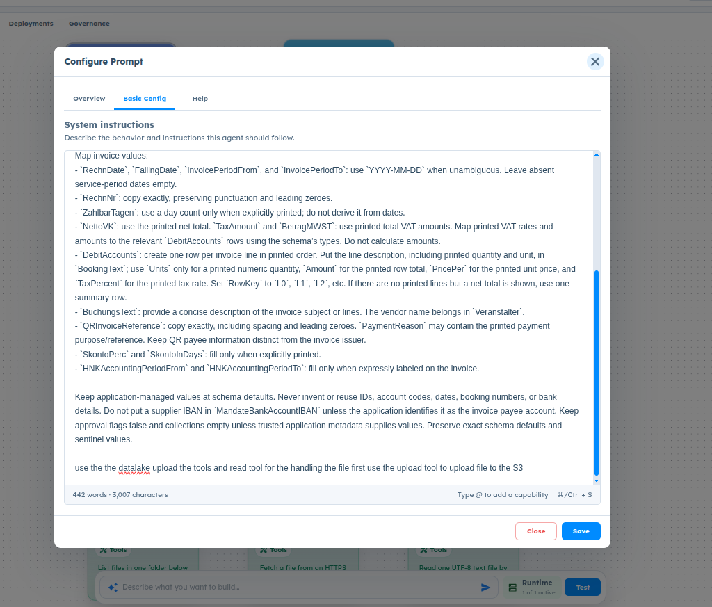

# ART-AGENT-010 — Configure Prompt System Instructions Textarea Recomposes on Periodic Re-render Resetting Cursor to Start Position

## Metadata

- **Canonical Bug ID:** ART-AGENT-010
- **Title:** Configure Prompt System Instructions Textarea Recomposes on Periodic Re-render Resetting Cursor to Start Position
- **Status:** OPEN
- **Feature:** Agent Lab
- **Module:** Agent Lab / Configure Prompt
- **Classification:** BUG
- **Severity:** HIGH
- **Priority:** P2
- **Assignee:** Unassigned
- **Environment:** Testing (Agent Lab / Configure Prompt / System instructions)
- **Tags:** Agent-Lab, Configure-Prompt, System-Instructions, Textarea, Re-render, Caret-Position, Cursor-Jump, UI-Glitch, State-Management, P2
- **Date Reported:** 2026-10-09
- **Azure DevOps:** SYNCED

## 1. Problem

In Agent Lab, when configuring an agent's System Instructions in the 'Configure Prompt' modal ('Basic Config' tab), the prompt textarea component intermittently recomposes or re-renders across a recurring timeframe or polling interval. This periodic re-render resets internal textarea cursor/caret state, forcibly moving the user's cursor from its active typing position back to the first character position (index 0). For users typing prompts interactively rather than pasting complete text, this causes severe input disruption and inserts new keystrokes at the start of the prompt.

## 2. Observed Behavior

- User opens the 'Configure Prompt' modal in Agent Lab under the 'Basic Config' tab.
- User types system instructions into the 'System instructions' textarea (visible placeholder: 'Describe the behavior and instructions this agent should follow.', footer showing '442 words · 3,007 characters').
- While the user is actively typing, a periodic re-render/recomposition occurs after a specific timeframe or interval.
- Upon re-render, the active cursor/caret position in the textarea abruptly jumps from the last typed character back to the first character position (index 0).
- Subsequent keystrokes typed by the user are erroneously prepended to the start of the prompt text rather than appended to the typing position, appearing as an erratic glitch.
- The issue does not affect users pasting pre-composed text in a single action, but directly disrupts anyone interactively composing or modifying prompts directly within the textarea.

## 3. Reproduction

1. Navigate to Agent Lab and open an agent workflow.
2. Click on 'Configure Prompt' to open the configuration modal.
3. Ensure the 'Basic Config' tab is selected.
4. Focus the 'System instructions' textarea and type instructions continuously over a period of time (e.g. 10–30 seconds) rather than pasting.
5. Observe the cursor behavior during active typing: after a periodic interval/re-render, the caret abruptly jumps to the first character position (index 0) of the textarea.
6. Continue typing without manually repositioning the cursor and observe subsequent characters being typed at the very beginning of the prompt.

## 4. Expected Behavior

The 'System instructions' textarea must maintain stable local component state and preserve the user's cursor/caret position across component re-renders or background updates. Background state reconciliation (such as autosave, token/word counting, or status polling) must not reset cursor position or force uncontrolled text recomposition while the input has active user focus.

## 5. Business Impact

Prompt engineers and developers building agents in Agent Lab cannot reliably compose or refine system prompts directly inside the platform UI. Key instructions are corrupted when characters are inserted at the beginning of the prompt, degrading user trust, frustrating authoring workflows, and forcing users to draft prompts in external editors before pasting.

## 6. User Experience

Users typing directly in the prompt textarea experience sudden and jarring cursor jumps. Keystrokes meant for the end or middle of sentences are suddenly entered at the start of the entire document. The interface feels unstable and glitchy during prompt editing.

## 7. Investigation Guidance

Inspect the 'Configure Prompt' modal and System Instructions textarea component in Agent Lab:
- Check how the prompt textarea value is managed (controlled vs uncontrolled component state in React).
- Identify background timers, intervals, autosave hooks, or parent component re-renders that fire periodically (e.g. word count debounce, autosave debounce, or canvas/runtime polling).
- Determine whether parent re-renders are causing the textarea or its container to re-mount (e.g. unstable keys or component recreation inside render bodies) or forcing a state update that overrides the DOM selectionStart and selectionEnd caret positions.
- Verify whether memoization (React.memo, useMemo, useCallback) is missing on the editor component or its callbacks, causing full tree re-renders on unrelated state changes.
- Ensure that if controlled value synchronization occurs from external props, it only synchronizes when the incoming value differs from the local editor state, preserving DOM caret position.

## 8. Fix Requirement

The System Instructions textarea must retain focus and preserve the user's caret selection position during all background re-renders, debounce cycles, and periodic state updates. Typing flow must remain smooth and uninterrupted.

## 9. Recommended Solution

1. Isolate the textarea input state into a local controlled state within the prompt editor component, ensuring that external updates (such as autosave or parent prop changes) do not re-initialize or reset caret offsets while the element has active focus.
2. Check for unnecessary component unmounting/remounting caused by anonymous function components or inline key definitions in the parent modal/tab switchers.
3. If an autosave or debounced sync triggers a parent re-render, memoize the textarea sub-component and preserve selectionStart and selectionEnd across value syncs using a ref or React state preservation.

## 10. Minimum Working Fix

Ensure the prompt textarea component does not remount on parent periodic updates and preserves caret position (selectionStart/selectionEnd) when controlled value props update, preventing cursor resets to character 0 during active typing.

## 11. Acceptance Criteria

- Continuous typing in the 'System instructions' textarea maintains the cursor at the active typing position without jumping to character 0.
- Periodic background updates (autosave, word/character counter, polling intervals) do not reset or alter the caret position during user input.
- Typing remains seamless and characters are appended/inserted exactly where the user is typing.
- Pasting and keyboard shortcuts (e.g., ⌘/Ctrl + S, @ capability trigger) continue to operate correctly.

## 12. Environment

Testing (Agent Lab / Configure Prompt / System instructions)

## 13. Severity

HIGH

## 14. Priority

P2

## 15. Tags

Agent-Lab, Configure-Prompt, System-Instructions, Textarea, Re-render, Caret-Position, Cursor-Jump, UI-Glitch, State-Management, P2

## 16. Assignee

Unassigned

## 17. Evidence

| Evidence File | Type | Description | SHA-256 | Size |
| ------------- | ---- | ----------- | ------- | ---- |
| [[ART-AGENT-010](ART-AGENT-010__configure-prompt-recomposing-cursor-reset__2026-10-09__01.png)] | Screenshot | Configure Prompt modal in Agent Lab showing System instructions textarea (442 words · 3,007 characters) where periodic re-rendering causes caret recomposition and resets cursor to index 0. | `d594c5bf3cb87752ac99b8d5b0f60ad4bc8745510e206c11a03ebbee80991dd7` | 236851 bytes |

## 18. Discussion

The tester reported that the prompt text box in Agent Lab has a recomposition / re-rendering glitch occurring across periodic time frames, causing the cursor position to move from the end of the text back to the first character (index 0). This causes characters typed directly in the box to be prepended rather than appended, disrupting prompt authoring.

## 19. Azure DevOps

- **Work Item ID:** 69076
- **URL:** [https://dev.azure.com/BixBytesSolutions/f3253417-808e-457f-a7f2-5699b2f38aa6/_workitems/edit/69076](https://dev.azure.com/BixBytesSolutions/f3253417-808e-457f-a7f2-5699b2f38aa6/_workitems/edit/69076)
- **Parent Feature:** Agent Lab
- **Parent Feature ID:** 68783
- **Assigned To:** Unassigned
- **Sync Status:** SYNCED
- **Note:** Synchronized via ART Bug Pipeline.

## Resolution Status

- **ART Disposition:** OPEN
- **Azure State:** New
- **Azure Reason:** New
- **Retest Required:** NO
- **Action Required:** AWAIT_DEVELOPER
- **Last Azure Sync:** 2026-10-12T06:45:01.364228+00:00

## Resolution History

### 2026-10-12 — Azure Lifecycle Update

Azure Work Item: #69076
Azure State: New
Azure Reason: New
Changed By: Chiranjeevi P.K

Developer Feedback:

Not provided

ART Assessment:

OPEN

Retest Required:

NO

Action Required:

AWAIT_DEVELOPER

Assessment Reason:

Issue remains open in Azure with no implementation or resolution claim established.
